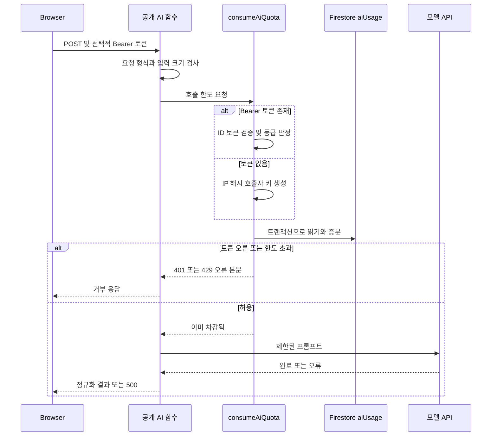

# 범위와 설계 의도

`openaiChatCompletions`와 `translateFlashcards`는 랜딩 데모를 포함한 비로그인 호출을 받아야 하므로 CORS를 허용하고 `invoker: "public"`으로 배포한 HTTP 함수다. 공개 invoker는 URL을 아는 비로그인 브라우저가 함수를 호출할 수 있게 하는 배포 조건이지, 요청을 신뢰한다는 뜻이 아니다. 앱도 프로덕션 Functions 기본 URL에 함수 이름을 붙여 POST하며 로그인 상태이면 Firebase ID 토큰을 `Authorization`에 보낸다. 따라서 URL 비공개화가 아닌 서버 측 인증 판정, 사용량 차감, 입력 제한이 보호 경계다.

이 두 함수는 모델 호출 전에 `consumeAiQuota`를 실행한다. 이 guard는 **인증 사용자별**, **비로그인 호출자별**, 그리고 **모든 비로그인 호출이 공유하는 전역**의 일일 상태를 서버에서 관리한다. 공개 URL이 필요하더라도 서버에서 호출을 식별하고, 동시 요청 사이에 한도를 넘겨 통과하지 않게 하는 목적이다.



*카드 생성·번역의 공개 요청이 모델 호출 전에 검증되고, 허용된 요청은 그 시점에 이미 사용량을 소비하는 순서다.*

## 인증 상태와 일일 버킷

| 호출 상태 | 서버 식별 | 일일 한도 | 추가 경계 |
| --- | --- | ---: | --- |
| 유효한 Firebase ID 토큰의 Free 사용자 | 검증된 `uid` | 100회 | 없음 |
| 유효한 Firebase ID 토큰의 Pro 사용자 | 검증된 `uid` | 300회 | 없음 |
| `Authorization`이 없는 데모 호출 | `X-Forwarded-For` 첫 IP 또는 `req.ip`의 해시 | 30회 | 비로그인 전체가 공유하는 500회 상한 |

`Bearer `로 시작하는 헤더가 있으면 익명 버킷으로 되돌아가지 않고 ID 토큰을 검증한다. 검증 실패는 카운터를 건드리지 않고 `401 UNAUTHENTICATED`를 반환한다. 헤더가 없을 때만 익명 정책을 적용한다. 이 때문에 로그인 호출 클라이언트가 토큰을 보내는 것은 UI 편의가 아니라 올바른 버킷 선택에 필요하다.

날짜 키는 현재 시각에 9시간을 더해 얻는 KST의 `YYYY-MM-DD`다. 각 사용량 문서의 `date`가 오늘과 다르면 기존 `count`를 0으로 간주하고, 다음 허용 요청이 새 날짜와 증가한 값으로 기록한다. 별도 일괄 초기화 작업 없이 일 경계가 적용된다.

## IP 식별은 보조 수단이며 전역 상한이 보완한다

비로그인 호출자는 원본 IP 대신 SHA-256 해시의 앞 32자를 문서 ID에 쓴다. 그러나 `X-Forwarded-For`의 첫 값은 호출자가 넣을 수 있으므로 이것만으로 신뢰할 수 있는 사용자 식별을 제공하지 않는다. 헤더 값을 바꾸면 호출자별 30회 한도를 피할 수 있다.

이를 보완하려고 guard는 IP 해시별 문서와 `anonGlobal` 문서를 **같은 Firestore 트랜잭션**에서 읽고 쓴다. 전역 카운터를 먼저 검사하므로 IP별 식별을 바꿔도 공유 상한에 도달하면 `429 DEMO_BUDGET_EXCEEDED`로 차단된다. 이 전역 값은 비로그인 호출의 총량을 제한하는 보완책이며, 이를 개별 요청의 비용 수치로 해석해서는 안 된다. 로그인 호출에는 이 공유 상한을 적용하지 않아, 데모 트래픽이 모두 소진되더라도 로그인 사용자의 생성·번역을 같이 막지 않는다.

더 강한 요청 출처 증명이 필요하다면 IP 해시만으로 해결되지 않는다. 예를 들어 App Check를 도입할 경우 클라이언트 등록과 enforcement를 함께 설계·운영해야 한다.

## 서버 소유 카운터와 원자성

`aiUsage`는 Firestore 규칙에 클라이언트 `match`가 없는 서버 전용 컬렉션이다. 반면 `users/{uid}`는 본인이 삭제할 수 있다. 사용량을 사용자 문서에 넣으면 삭제·재생성으로 한도를 초기화할 수 있으므로, guard는 사용자 문서에서 등급만 읽고 사용량은 별도 컬렉션에 둔다. 관련 저장소 소유권은 [Firestore 데이터 경계](firestore-data-boundary.md)에서 확인할 수 있다.

- 로그인 호출은 `user__${uid}`를 트랜잭션에서 읽고, 오늘의 카운트가 해당 등급 한도보다 작을 때만 1 증가시킨다.
- 익명 호출은 `anon__${ipHash}`와 `anonGlobal`을 하나의 트랜잭션에서 함께 갱신한다. 읽기와 쓰기를 나누면 동시 요청이 같은 잔여 횟수를 보고 함께 허용될 수 있다.
- 일반 한도 초과는 `429 LIMIT_EXCEEDED`와 적용 한도를 반환하고, 익명 전역 상한 초과는 `429 DEMO_BUDGET_EXCEEDED`를 반환한다. 거부된 트랜잭션은 카운터를 증가시키지 않는다.

## 입력 크기 경계: 생성은 절단, 번역은 거부

호출 횟수만 제한하면 요청 하나가 지나치게 큰 프롬프트가 되는 문제는 남는다. 두 경로는 의도적으로 서로 다른 처리 계약을 가진다.

| 경로 | 서버 경계 | 상한 초과 시점과 처리 |
| --- | --- | --- |
| 카드 생성 `openaiChatCompletions` | 공용 `requestFlashcardCompletion`의 본문 30,000자 | guard를 통과한 뒤, 모델 요청 직전에 앞부분으로 절단하고 경고를 남긴다. 큰 입력도 생성 흐름은 계속한다. |
| 카드 번역 `translateFlashcards` | 카드 200장 | guard 및 모델 호출 전에 `413 PAYLOAD_TOO_LARGE`로 거부한다. |
| 카드 번역 `translateFlashcards` | 질문·답변 쌍을 JSON으로 직렬화한 본문 120,000자 | 같은 시점에 `413 PAYLOAD_TOO_LARGE`로 거부한다. |

번역은 모델의 배열을 원본 카드의 인덱스에 맞춰 다시 결합한다. 입력을 임의로 자르면 카드 대응이 깨질 수 있으므로 절단하지 않는다. 모델이 다른 수의 항목을 반환하면 경고를 남기고, 누락된 항목은 원래 질문·답변을 유지한다. 반대로 생성 경로의 공용 호출은 실시간 생성뿐 아니라 사전 생성에서도 사용되므로, 절단 규칙이 그 공용 모델 경계에 집중되어 있다. 경로 관계는 [카드 생성 경로](../flashcard/generation-paths.md)를 참고한다.

## 차감 시점과 실패 계약

생성은 필수 `text`와 서버 구성 상태를 확인한 뒤 guard를 실행한다. 번역은 HTTP 메서드, 요청 구조, 카드 수, 직렬화 길이를 먼저 검사한 뒤 guard를 실행한다. 따라서 번역의 잘못되었거나 너무 큰 요청은 쿼터를 쓰지 않는다. 생성의 긴 입력은 거부하지 않으므로 쿼터를 차감한 뒤 절단된다.

guard가 `allowed`를 반환할 때 Firestore 증분은 이미 완료되어 있다. 이후 모델 호출 실패, 네트워크 오류, 모델 응답의 JSON 파싱 오류를 되돌리는 환불 로직은 없다. 즉 생성·번역은 성공 결과를 돌려주지 못해도 허용된 요청 하나를 소비한다. 환불이나 재시도를 추가하려면 오류 처리기에 단순 감소를 붙이지 말고, 요청 식별자와 예약·확정 상태를 둔 별도 설계로 중복 재시도와 중복 환불을 방지해야 한다.

# 질문 재생성은 독립된 서버 강제 경계

`regenerateCardQuestion`도 CORS와 공개 invoker를 사용하지만 `consumeAiQuota`를 호출하지 않는다. 따라서 위의 `aiUsage` 한도, IP 전역 상한, 생성·번역의 선차감 의미를 재생성에 적용해서는 안 된다. 재생성은 함수 내부에서 인증 여부와 별도의 컬렉션으로 직접 판정하고, 최종 거부도 서버가 수행한다. 클라이언트의 남은 횟수 표시는 보조 정보일 뿐이다.

| 재생성 호출 상태 | 서버 식별 및 저장소 | 일일 한도 | 강제 순서 |
| --- | --- | ---: | --- |
| Bearer 토큰이 있는 사용자 | 검증된 `uid`, `regenerateCounts/{uid}` | Free 3회, Pro 20회 | 현재 카운트를 확인하고 한도면 429, 모델 성공·응답 파싱 뒤 기록 |
| 토큰이 없는 데모 | 필수 `demoDeviceId` 해시, `demoRegenerateCounts/{hash}` | 1회 | 기기 ID와 현재 카운트를 확인하고 한도면 429, 모델 성공·응답 파싱 뒤 기록 |

`regenerateCounts/{uid}`는 본인에게 읽기만 허용하고, `demoRegenerateCounts`는 규칙 매치가 없어 클라이언트 접근이 기본 거부된다. 그러므로 이 카운터의 값은 요청 본문이나 클라이언트 상태가 아니라 HTTP 함수가 강제한다. 로그인 경로는 Bearer 헤더가 있으면 ID 토큰을 요구하고, 데모 경로는 헤더가 없을 때 `demoDeviceId`를 요구한다.

이 경계에는 생성·번역 guard와 중요한 차이가 두 가지 있다.

1. 재생성은 모델 응답과 JSON 파싱이 성공한 **후** 카운터를 기록한다. 모델 실패나 파싱 실패는 이 카운터를 증가시키지 않는다.
2. 현재 카운트 확인과 이후 `set`은 Firestore 트랜잭션이 아니다. 동시에 여러 요청이 같은 이전 카운트를 읽으면 각각 모델을 호출하고 같은 다음 카운트를 기록할 수 있다. 재생성 한도를 엄격한 동시성 경계로 바꾸려면 생성·번역 guard처럼 확인과 예약을 단일 트랜잭션으로 묶고, 실패 때의 확정·환불 의미를 명시해야 한다.

재생성 함수 코드에는 `rawDiff`, 기존 질문·답변으로 구성하는 모델 본문에 대한 문자 수 절단 또는 거부 검사가 없다. 그러므로 생성의 30,000자 절단이나 번역의 413 상한이 이 경로에도 있다고 가정하지 말고, 입력 크기 경계가 필요하면 재생성 함수에 별도로 추가해야 한다.

# 변경 및 검증 지침

- 공개 함수 이름 또는 기본 URL을 바꾸면 생성·번역 클라이언트가 조합하는 URL과 개발 환경의 `/api` 프록시를 함께 검토한다. 클라이언트 타임아웃으로 브라우저가 요청을 중단해도 서버가 이미 guard를 통과했을 수 있으므로, 재시도 UX는 선차감 의미를 고려한다.
- 한도나 구독 등급을 바꾸면 `ai-guard.ts`의 상수뿐 아니라 서버가 신뢰하는 `users/{uid}.subscriptionTier`의 Firestore 쓰기 경계도 함께 검토한다.
- `aiUsage`의 문서 ID 형식과 `anonGlobal`은 정책 상태다. 이름이나 저장 위치를 바꾸려면 기존 일일 사용량의 연속성과 클라이언트 비쓰기 불변식을 명시적으로 이전한다.
- 재생성에 원자적 예약을 추가할 때는 성공 뒤 기록이라는 현재 의미가 바뀐다. 모델 실패, 타임아웃, 파싱 실패, 동시 요청, 날짜 경계 각각에서 카운터가 언제 소비되는지 테스트로 고정한다.
- Functions 변경 뒤에는 최소한 다음을 실행하고 Emulator에서 유효 토큰·없는 토큰·잘못된 Bearer 토큰, 번역의 두 413 경우, 각 한도 도달, 모델 실패 뒤 재호출을 확인한다.

```bash
pnpm --prefix functions run lint
pnpm --prefix functions run build
```
