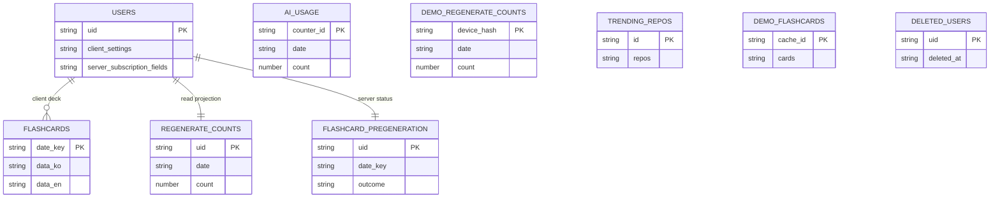

`firestore.rules`는 브라우저 Firestore SDK의 권한 경계다. 반면 Cloud Functions의 Admin SDK는 이 규칙을 적용받지 않는다. 따라서 경계의 핵심은 **사용자가 직접 관리해도 되는 문서만 규칙으로 열고, 한도·작업 완료 기록처럼 사용자가 삭제로 초기화하면 안 되는 상태는 규칙에 `match`를 만들지 않는 별도 컬렉션에 둔다**는 것이다.

`USERS`와 `FLASHCARDS`는 본인 클라이언트가 소유하는 쓰기 영역이고, `USERS` 안의 구독 필드는 서버만 쓴다. `REGENERATE_COUNTS`는 사용자에게 읽기만 보이는 투영이며, `FLASHCARD_PREGENERATION`, `AI_USAGE`, `DEMO_REGENERATE_COUNTS`는 기본 거부 서버 영역이다. `TRENDING_REPOS`와 `DEMO_FLASHCARDS`는 공개 읽기 캐시다.

## 컬렉션별 접근 모델

| 경로 | 클라이언트 권한 | 클라이언트 소유/표시 필드 | 서버 전용 역할 |
|---|---|---|---|
| `users/{uid}` | 인증 UID와 문서 ID가 같은 본인만 읽기·생성·갱신·삭제 | `repositories`, 온보딩·푸시·시간대·언어·갱신 시각, GitHub 접근 자격 증명 | 같은 문서의 `subscriptionTier`, `subscriptionPeriodEnd`, `stripeCustomerId`는 서버 전용 필드 |
| `users/{uid}/flashcards/{YYYY-MM-DD}` | 본인 읽기·쓰기 | 언어별 `data_ko`/`data_en` 덱 | 사전 생성 작업도 Admin SDK로 같은 문서에 병합 |
| `regenerateCounts/{uid}` | 본인 읽기만 | 남은 횟수 표시용 `date`, `count` | 재생성 함수만 기록 |
| `meta/trendingRepos`, `demoFlashcards/{cacheId}` | 누구나 읽기, 클라이언트 쓰기 없음 | 공개 가능한 Trending 목록과 데모 카드만 | 스케줄러가 생성·갱신·정리 |
| `aiUsage`, `demoRegenerateCounts`, `flashcardPregeneration` | 규칙 `match`가 없어 읽기·쓰기·삭제 모두 기본 거부 | 없음 | AI 사용량, 데모 재생성 사용량, 사전 생성 완료 상태 |
| `deletedUsers/{uid}` | 본인 읽기·생성만 | 탈퇴 당일 재가입 확인에 쓰는 탈퇴 기록 | 클라이언트 삭제는 규칙으로 열려 있지 않음 |
| `notices/{noticeId}` | 인증 사용자 읽기만 | 공지 표시 | 콘솔 등 서버 측 운영 경로의 쓰기 |

규칙의 `match`가 없는 컬렉션은 “서버 전용”이라는 별도 기능이 아니라 기본 거부의 결과다. Admin SDK는 이 규칙을 우회하므로 서버 코드가 그 상태의 유일한 읽기·쓰기 주체가 된다.

## 사용자 문서의 필드 경계

`users/{uid}` 생성은 문서의 모든 키가 `userWritableFields()` 허용 목록에 있어야 하고, 갱신은 `diff(...).affectedKeys()`만 그 목록 안에 있어야 한다. 갱신에서 바뀐 키만 검증하는 설계이므로 이미 존재하는 서버 필드를 보존한 채 클라이언트 설정을 병합할 수 있다. 반대로 클라이언트가 구독 필드를 추가·수정·삭제하면 변경 키 검사에서 거부된다.

허용된 필드는 다시 타입과 크기를 검증한다. 예를 들어 저장소 목록은 최대 5개이고 각 항목은 `fullName`과 HTTPS `url`을 요구하며, `branch` 이외의 추가 키를 허용하지 않는다. 언어는 `ko`/`en`만 허용하고 푸시 시각과 문자열 필드도 범위를 제한한다. 이 검증은 UI의 Free/Pro 선택 제한을 보안 경계로 간주하지 않게 한다.

`updatedAt`은 Firestore `timestamp` 또는 제한된 길이의 문자열을 허용한다. 서비스 워커에 남아 새 규칙 배포 뒤에도 실행될 수 있는 이전 번들이 `Date`를 쓸 수 있으므로, 이 호환 표현을 즉시 제거하면 이전 클라이언트의 설정 저장이 실패한다. 이는 Firestore IndexedDB 영속성 설정과는 별개다. 클라이언트 초기화는 `getFirestore(app)`만 호출하며 영속성을 명시적으로 활성화하지 않는다.

설정 화면은 `setDoc(..., { merge: true })`와 `updateDoc`로 자기 필드만 쓴다. 저장소 설정을 저장한 뒤에는 해당 사용자의 일별 덱 문서를 직접 삭제해 새 생성 경로를 시작하고, 푸시 설정도 관련 필드만 병합한다. 따라서 `users` 허용 목록 또는 덱 규칙을 변경할 때는 이 직접 쓰기·삭제 경로와 `useTodayFlashcards`의 덱 저장을 모두 함께 확인해야 한다.

### 구독 필드와 Stripe 모듈의 현재 상태

`functions/src/stripe.ts`에는 웹훅이 Admin SDK 병합 쓰기로 구독 등급과 기간을 갱신하는 구현이 있다. 하지만 Functions 진입점 `functions/src/index.ts`는 이 모듈을 export하지 않고 주석으로 남겨 두었고, 패키지의 `main`도 `lib/index.js`다. 그러므로 이 코드는 **서버 전용 필드의 소유 모델을 설명하는 구현**이지만, 현재 Functions 엔트리포인트에서 배포되는 Stripe 함수라고 가정해서는 안 된다. 규칙은 이 상태와 무관하게 클라이언트의 구독 필드 쓰기를 계속 막는다.

## 삭제해도 초기화되지 않아야 하는 카운터

본인 `users/{uid}` 삭제는 탈퇴 흐름을 위해 허용된다. 그래서 일일 한도나 작업 완료 상태를 이 문서에 넣고 “특정 필드를 쓰지 못하게 했으니 안전하다”고 판단하면 안 된다. 문서 전체 삭제 후 재생성이라는 우회가 남기 때문이다.

- `aiUsage`는 로그인 호출의 UID별 카운터와 비로그인 호출의 IP 해시별·전역 카운터를 트랜잭션으로 차감한다. 인증 호출의 한도 등급은 `users`의 구독 필드를 읽지만, 차감 상태 자체는 서버 전용 컬렉션에 남는다. 호출 경계의 상세는 [AI 호출 가드](ai-call-guard.md)를 참고한다.
- `regenerateCounts/{uid}`는 UI가 `onSnapshot`으로 읽어 버튼 상태를 표시하는 읽기 전용 투영이다. `regenerateCardQuestion`이 날짜별 한도를 검사하고 모델 응답을 정상 처리한 뒤 Admin SDK로 기록한다. UI의 `canRegenerate`는 편의 표시이며 최종 제한은 서버의 429 응답이다.
- 비로그인 재생성은 기기 식별자 해시를 키로 하는 `demoRegenerateCounts`에 별도로 기록한다. 역시 클라이언트는 이 컬렉션에 접근할 수 없다.

이 분리는 `users`를 삭제해도 카운터가 사라지지 않게 한다. 한도가 필요한 새 기능은 `users`에 카운터를 추가하는 대신, 서버 전용 원장과 필요한 최소 읽기 전용 투영을 별도로 설계해야 한다.

## 일별 덱과 사전 생성의 경합

클라이언트는 오늘 문서에서 현재 언어 덱을 먼저 읽고, 다른 언어 덱이 있으면 번역본을 병합해 저장하며, 둘 다 없을 때 생성 결과를 저장한다. 모든 저장은 덱 크기 예산을 적용한다. 동시에 서버의 사전 생성은 `users`에서 시간대·언어·저장소 설정을 읽어 사용자 로컬 새벽에 태스크를 등록한다.

덱 문서가 없는 것만으로는 “아직 시도하지 않음”과 “커밋이 없어 만들 카드 없음”을 구분할 수 없다. 따라서 `flashcardPregeneration/{uid}`에는 날짜와 `saved`·`exists`·`empty`·`unavailable` 완료 결과를 기록한다. 스케줄러는 같은 날짜의 완료 기록이 있는 사용자를 건너뛰며, 일시 오류로 결과를 확정하지 못하면 완료 기록 없이 재시도한다.

사용자가 먼저 앱에서 덱을 만들 수 있으므로 작업은 두 번 방어한다. 생성 전 기존 언어 덱이 하나라도 있으면 `exists`로 끝내고, 생성 후 저장 트랜잭션에서도 다시 존재 여부를 확인한다. 트랜잭션이 기존 덱을 보면 쓰지 않아 앱의 결과를 덮어쓰지 않는다. 작업 수명과 재시도는 [플래시카드 사전 생성](../flashcard/pregeneration.md), 문서 크기 제약은 [덱 크기 예산](../flashcard/deck-size-budget.md)을 참고한다.

## 공개 읽기 캐시와 경로 불일치

랜딩은 인증 없이 `meta/trendingRepos`와 `demoFlashcards/{cacheId}`를 읽는다. `refreshTrendingRepos`는 최소 개수에 못 미치는 수집 결과로 기존 Trending 캐시를 덮어쓰지 않고, 유효한 목록을 저장한 뒤 데모 카드를 생성하고 목록에서 빠진 캐시를 정리한다. 클라이언트는 캐시 읽기가 실패하거나 문서가 없으면 대체 생성 경로를 사용할 수 있다. 공개 읽기 컬렉션에는 사용자 설정, 사용자 덱, 접근 자격 증명처럼 공개하면 안 되는 데이터를 넣지 않는다.

규칙은 인증 사용자에게 `notices/{noticeId}` 읽기만 허용한다. 그러나 설정 화면이 구독하는 경로는 `config/notice`다. 이 경로에는 `match`가 없으므로 현 규칙에서는 기본 거부다. 공지 기능을 변경할 때는 클라이언트 경로를 `notices`로 맞추거나, 공개 범위와 인증 요건을 정한 전용 규칙을 `config/notice`에 추가해야 한다.

`deletedUsers/{uid}`도 현재 경계를 그대로 이해해야 한다. 설정 화면은 탈퇴 기록을 만든 후 하위 덱과 사용자 문서를 삭제한다. 로그인 화면은 과거 기록의 삭제를 시도하지만, 규칙은 이 컬렉션에 `delete`를 허용하지 않는다. 따라서 탈퇴 기록의 보존·정리 정책을 바꿀 때는 이 직접 삭제 시도와 규칙을 함께 수정하거나 서버 정리 경로를 마련해야 한다.

## 규칙 또는 스키마 변경 체크리스트

1. **소유자와 삭제 의미를 먼저 정한다.** 사용자 설정이면 `users`의 생성 허용 목록, 갱신 변경 키, 타입 검증을 모두 바꾼다. 한도·결제 권한·중복 방지·완료 상태면 서버 전용 컬렉션으로 분리한다.
2. **모든 직접 SDK 쓰기를 대조한다.** 설정의 병합 저장·덱 삭제·탈퇴 기록 생성, 로그인 시 사용자 문서 생성/갱신, `useTodayFlashcards`의 덱 병합이 새 규칙과 맞는지 확인한다. 하위 컬렉션 삭제는 부모 문서 삭제와 별개라는 점도 고려한다.
3. **Admin SDK 쓰기도 대조한다.** 사전 생성의 `users` 읽기와 덱 트랜잭션, 재생성 카운터 기록, AI 사용량 트랜잭션, Trending·데모 캐시 스케줄러를 검토한다. Admin SDK는 규칙 통과 여부로 보호되지 않으므로 서버에서 입력·경합·공개 범위를 보장해야 한다.
4. **롤링 배포를 허용한다.** PWA 캐시에 남은 이전 번들과 새 규칙이 공존한다. `updatedAt`처럼 이전의 유효 표현이 있는지 확인하고, 호환 기간 없이 타입을 좁히지 않는다.
5. **에뮬레이터 규칙 테스트를 추가한다.** 현재 저장소에는 Firestore 규칙 전용 테스트 파일이 보이지 않는다. 최소한 타 UID 접근, 허용되지 않은 생성·수정·삭제, 서버 필드를 포함한 기존 문서의 병합 갱신, 공개 캐시의 읽기/쓰기, 사용자 문서 삭제 뒤 서버 카운터 보존을 검증 대상으로 삼는다.

GitHub 접근 자격 증명의 사용 경계는 [GitHub 접근](../integrations/github-access.md), 푸시 설정을 소비하는 서버 작업은 [푸시 알림 운영](../operations/push-notifications.md)을 함께 확인한다.
