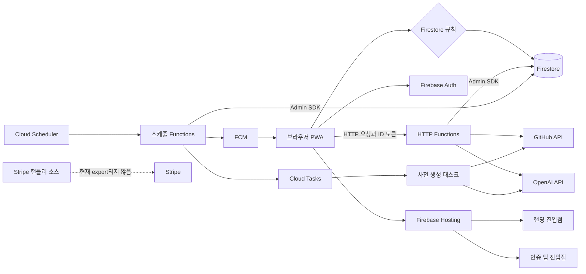

# 시스템 개요와 런타임 경계

CodeRecall은 정적 React PWA와 Firebase Cloud Functions를 분리한다. 브라우저는 Firebase Auth로 사용자를 식별하고 Firestore 규칙이 허용한 본인 데이터 및 공개 캐시만 직접 다룬다. 반대로 GitHub 토큰을 이용한 조회, OpenAI 호출, 사용량·완료 상태 갱신, 전체 사용자 대상 작업은 Functions의 Admin SDK 경로에 둔다. 이 분리는 비밀 값 노출을 막는 것뿐 아니라, 클라이언트가 한도나 완료 기록을 지워 비용·중복 방지 장치를 우회하지 못하게 하는 신뢰 경계다.

*실제 배포 경로는 실선으로, 구현은 있으나 Functions 진입점에서 내보내지 않아 배포되지 않는 Stripe 경로는 점선으로 나타낸다.*

## 웹 진입점과 Hosting 경계

Vite는 랜딩 `index.html`과 앱 `app.html`을 별도 Rollup 입력으로 빌드한다. 랜딩은 `landing-main.tsx`에서 React Query와 랜딩 화면을, 앱은 `main.tsx`에서 인증 앱과 메시징 서비스 워커를 초기화한다. PWA manifest의 시작 URL은 `/app`이므로 설치형 앱과 마케팅 랜딩의 진입 의도도 분리된다.

Hosting은 `app/dist`를 제공하며 `/app`과 `/app/**`만 `app.html`로 rewrite한다. `/terms`, `/privacy`는 정적 문서로 향하고, `/`은 랜딩 HTML을 그대로 제공한다. 서비스 워커의 `navigateFallback`도 `app.html`이므로, 새 앱 경로를 추가할 때는 Vite 입력·Hosting rewrite·서비스 워커 fallback이 같은 URL 계약을 갖는지 함께 검토해야 한다.

개발 환경에서 브라우저 API 클라이언트는 `/api`를 사용하고 Vite가 모드별 Functions URL로 프록시하면서 접두사를 제거한다. 프로덕션은 환경 변수의 Functions URL을 직접 사용한다. 브라우저는 현재 Firebase 사용자에게서 ID 토큰을 얻어 `Authorization: Bearer` 헤더에 넣으므로, 함수 이름이나 주소를 변경하면 이 호출 계약도 함께 확인해야 한다.

## 배포 단위와 데이터 권한

`firebase.json`은 Hosting, Firestore 규칙, Functions를 한 Firebase 설정으로 묶되, Functions는 별도 TypeScript 산출물을 배포 전 빌드한다. Functions 진입점은 Admin 앱을 초기화하고 전역 `maxInstances: 10`을 설정한다. Node.js 22 런타임의 이 상한은 컨테이너 확장에 따른 비용과 외부 API 부하를 제한하는 공통 제약이며, 태스크 큐의 동시 실행 제한과는 별개다.

Firestore 클라이언트 SDK는 규칙을 통과해야 한다. `users/{uid}`와 그 카드 하위 컬렉션은 소유자만 접근하며, 사용자 문서에서 클라이언트가 바꿀 수 있는 필드와 형태도 제한한다. 반면 랜딩이 쓰는 `meta/trendingRepos`와 `demoFlashcards`는 비로그인도 읽을 수 있는 서버 작성 캐시다. `aiUsage`, `flashcardPregeneration`처럼 한도·중복 방지에 쓰이는 상태에는 클라이언트 규칙이 없어 기본 거부된다. Admin SDK는 이 규칙을 우회하므로 함수는 UID, 입력 및 쓰기 대상을 직접 검증해야 한다. 세부 컬렉션 계약은 [Firestore 데이터 경계](firestore-data-boundary.md)를 참고한다.

## 요청 경로: 인증, 외부 제공자, 비용 제어

HTTP 함수의 `invoker: "public"`과 CORS는 URL 도달 및 브라우저 preflight를 허용할 뿐, 사용자 권한을 부여하지 않는다. GitHub 함수는 Firebase ID 토큰을 검증한 뒤 해당 UID의 Firestore 설정에서 GitHub 토큰과 허용된 저장소를 읽어 GitHub API를 호출한다. 따라서 공개 함수 URL만으로 다른 사용자의 저장소를 지정해 읽는 경로는 허용되지 않는다. 파일 원문 조회의 비로그인 경로는 GitHub 호스트만 허용하고, 토큰이 없으면 공개 리소스에만 의존한다. 상세한 접근 계약은 [GitHub 접근](../integrations/github-access.md)을 참고한다.

랜딩 데모를 위해 OpenAI 관련 HTTP 함수 일부도 공개되어 있다. 다만 모델 호출 전 서버 전용 `aiUsage` 카운터를 Firestore 트랜잭션으로 차감한다. 로그인 호출은 검증된 UID와 등급 기준 한도를, 비로그인 호출은 IP 해시 기준 한도와 별도의 전역 일일 상한을 함께 적용한다. IP 헤더는 단독 식별 경계가 될 수 없으므로 전역 카운터가 비용의 최종 상한 역할을 한다. 번역 경로는 카드 수와 프롬프트 길이도 거부형 상한으로 제한한다. 이 가드의 한계와 변경 주의점은 [공개 AI 함수 호출 경계](ai-call-guard.md)를 참고한다.

GitHub Trending은 브라우저가 외부 HTML을 직접 읽지 않고 공개 Firestore 캐시를 읽는다. `refreshTrendingRepos`는 매일 09:00 KST에 `asia-northeast3`에서 Trending 상위 10개를 수집한다. 파싱 결과가 5개 미만이면 기존 캐시를 보존하며, 목록 저장 후 데모 카드 사전 생성 또는 오래된 카드 정리에 실패해도 목록 캐시를 되돌리지 않는다. 따라서 외부 HTML 구조나 모델 호출 실패가 랜딩의 마지막 정상 목록을 즉시 지우지 않는다.

## 스케줄러, 태스크 및 사용자 시간대

| 작업 | 실행 경계 | 실패·부하 제어 |
| --- | --- | --- |
| `sendDaily8amPush` | 매시 `asia-northeast3`에서 실행하고, 각 사용자 IANA 시간대의 현지 시와 선호 시각이 일치할 때 FCM을 보낸다. 알림 클릭 데이터는 `/app`을 가리킨다. | FCM 토큰은 500개씩 보낸다. 전송 오류는 기록하지만 작업 전체 오류를 다시 던지지는 않는다. |
| `scheduleFlashcardPregeneration` | 매시 실행하여 현지 0시 이상 6시 미만이고 최근 활동한 사용자만 고르고, 사용자별 Cloud Tasks를 넣는다. | 같은 시각의 태스크 ID는 중복 등록을 막고, 등록 실패가 있으면 예외로 Scheduler 재시도를 유도한다. |
| `pregenerateUserFlashcards` | 큐가 사용자별 GitHub 커밋 조회와 OpenAI 카드 생성을 수행한 뒤 해당 날짜 덱을 저장한다. | 최대 동시 디스패치는 5, 최대 시도는 3회다. 한 태스크 안의 병렬 모델 호출까지 고려한 속도·비용 경계다. |
| `refreshTrendingRepos` | 매일 09:00 KST에 공개 Trending·데모 캐시를 갱신한다. | 실행 시간과 메모리 설정을 별도로 늘려 목록과 데모 생성의 긴 경로를 수용한다. |

스케줄러의 기준 시간대만으로 사용자 현지 날짜를 정하지 않는다. 푸시와 사전 생성은 `Intl.DateTimeFormat`으로 각 사용자의 IANA 시간대를 해석한다. 사전 생성 후보는 유효하지 않은 시간대, 언어 또는 저장소 설정이 없으면 제외한다. 이 방식은 모든 시간대를 매시 확인하는 비용을 감수하는 대신, 기기와 서버가 같은 사용자 날짜 키 및 커밋 조회 범위를 사용하게 한다.

사전 생성은 후보 선정과 무거운 생성을 분리한다. 완료 기록은 서버 전용 `flashcardPregeneration`에 남겨 ‘커밋이 없어 빈 덱’과 ‘아직 실행하지 않음’을 구별한다. 태스크는 기존 덱을 먼저 확인하고, 저장 트랜잭션에서 다시 확인한다. 그러므로 자정 직후 앱이 먼저 생성한 덱을 서버가 덮어쓰지 않는다. GitHub 인증 문제처럼 재시도로 해결되지 않는 상태, 실제 커밋 없음, 저장 성공은 완료로 기록한다. 반대로 일부 생성 오류 때문에 빈 덱이 되면 완료로 기록하지 않고 태스크 재시도 및 다음 새벽 시간대의 재등록 여지를 남긴다. 사용자 생성과의 관계는 [플래시카드 생성 경로](../flashcard/generation-paths.md), 큐 세부 사항은 [사전 생성](../flashcard/pregeneration.md)을 참고한다.

## Stripe: 구현 의도와 현재 런타임 상태

`functions/src/stripe.ts`에는 인증된 사용자의 Checkout 세션 생성과 서명 검증 웹훅이 구현되어 있다. 웹훅의 의도는 구독 이벤트에 따라 사용자 문서의 구독 등급 및 기간 상태를 Admin SDK로 갱신하는 것이다. 그러나 `functions/src/index.ts`는 이 모듈의 export를 주석 처리했다. 따라서 이 저장소의 현재 Functions 배포 진입점에는 Checkout 및 웹훅 HTTP 핸들러가 **포함되지 않는다**. 프런트엔드의 결제 복귀 UI나 Firestore 규칙의 서버 전용 구독 필드만으로 Stripe 런타임이 활성화됐다고 가정해서는 안 된다. 활성화하려면 export뿐 아니라 서명 검증, 허용된 반환 URL 정책, 환경 설정 및 엔드투엔드 이벤트 검증을 함께 준비해야 한다.

## 변경·운영 확인

- **리전 변경:** HTTP 함수, Scheduler, 태스크 함수 및 `locations/${REGION}/functions/pregenerateUserFlashcards` 큐 경로는 모두 `asia-northeast3` 계약에 연결된다. 일부만 옮기면 큐가 다른 함수를 가리키거나 브라우저의 Functions URL과 불일치할 수 있다.
- **용량 변경:** 전역 `maxInstances`와 태스크의 `maxConcurrentDispatches`를 함께 평가한다. 후자만 올려도 사용자별 병렬 GitHub·OpenAI 요청량이 늘어나며, 전자를 올려도 외부 제공자의 속도 제한은 자동으로 완화되지 않는다.
- **권한 변경:** 공개 캐시에 개인 토큰·사용량 상태를 넣지 않는다. 서버 전용 컬렉션을 규칙으로 열면 사용자가 비용 한도나 완료 기록을 변경할 수 있으므로, 필요한 표시 전용 데이터만 별도로 읽기 허용한다.
- **검증:** 이 저장소의 빌드 경계는 `pnpm --filter app build` 및 `pnpm --filter functions build`이다. 변경 시 두 빌드 뒤 Hosting의 `/app` rewrite, 비로그인 공개 캐시 읽기, ID 토큰이 필요한 GitHub 요청, AI 한도 초과 응답, 사전 생성의 중복 덱 방지와 태스크 재시도를 Emulator 또는 배포 환경에서 확인한다. 로컬 실행과 배포 절차는 [로컬 개발 및 배포](../operations/local-development-and-deployment.md), 수신 측 푸시 설정은 [푸시 알림](../operations/push-notifications.md)을 참고한다.
