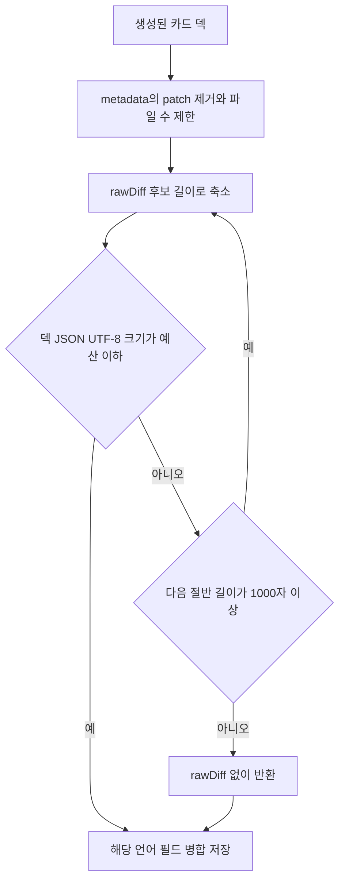

`users/{uid}/flashcards/{YYYY-MM-DD}` 문서에는 언어별 배열 `data_ko`, `data_en`가 함께 들어간다. Firestore 문서는 1 MiB(1,048,576 bytes)를 넘으면 쓸 수 있다. 커밋 하나에서 여러 카드가 만들어지고 각 카드가 같은 원문 diff를 가질 수 있으므로, **카드 개수**만으로는 문서 크기를 예측하거나 제한할 수 없다. 예를 들어 카드 한 장의 긴 `rawDiff`나 `files[].patch`만으로도 한도가 문제가 될 수 있고, 짧은 카드가 많아도 직렬화 결과는 커질 수 있다.

그래서 이 정책은 저장 직전 덱의 JSON UTF-8 직렬화 크기를 제한한다. Firestore가 계산하는 실제 저장 크기와 완전히 같은 계산식은 아니지만, JSON의 따옴표와 이스케이프를 포함해 보수적으로 판정한다. 문서 소유권과 클라이언트 접근 권한은 [Firestore 데이터 경계](../architecture/firestore-data-boundary.md)를 참고한다.

## 예산과 측정 기준

| 항목 | 값 | 의미 |
|---|---:|---|
| Firestore 문서 상한 | 1,048,576 bytes | 넘으면 문서 쓰기가 거부되는 상한 |
| `MAX_FLASHCARD_DOC_BYTES` | 900,000 bytes | 필드명·여유를 고려한 안전 상한 |
| `FLASHCARD_DECK_BUDGET_BYTES` | 450,000 bytes | 두 언어 덱이 한 문서의 안전 상한을 공유하므로 언어별로 배정한 기본 예산 |
| `MAX_RAW_DIFF_CHARS` | 30,000자 | 카드 `rawDiff`의 첫 후보 상한 |
| `MIN_RAW_DIFF_CHARS` | 1,000자 | 이보다 더 줄여야 하면 `rawDiff`를 생략하는 경계 |
| `MAX_FILES_PER_CARD` | 20개 | 카드당 보존하는 파일 목록 상한 |

앱의 `measureFlashcardDeckBytes`는 `TextEncoder().encode(JSON.stringify(deck)).length`를, 서버 구현은 `Buffer.byteLength(JSON.stringify(deck), "utf8")`를 사용한다. 즉 제한 대상은 카드 수나 원본 diff의 문자 수가 아니라 **축소된 덱 배열을 JSON으로 만들었을 때의 UTF-8 바이트 수**다. 두 언어 배열을 담는 문서의 나머지 필드까지 정확히 모델링하지 않으므로, 문서 상한보다 낮은 안전 상한을 둔다.



*저장 전 축소 후보를 순서대로 검사하고, 마지막에는 diff 없는 표현으로 돌아가는 흐름을 보여 준다.*

## 축소 대상과 순서

`fitFlashcardDeckToBudget`은 카드 목록을 삭제하거나 질문·답변을 자르지 않는다. 대신 각 카드의 **메타데이터 중 저장 용량이 큰 중복·원문 표현**을 다음 순서로 줄이고, 매 후보마다 덱 전체를 측정한다.

1. `metadata.files[].patch`를 제거한다. 같은 변경 내용은 `rawDiff`에도 들어갈 수 있으며, 파일 보기 탭은 남은 `filename`, `raw_url` 같은 파일 정보로 원본을 다시 가져올 수 있다.
2. `files`가 있으면 앞의 20개만 남긴다.
3. `rawDiff`가 있으면 30,000자부터 `30,000 → 15,000 → 7,500 ...`처럼 절반씩 줄인다. 이 중 예산에 처음 들어오는 후보를 선택한다.
4. 1,000자 이상의 모든 후보도 맞지 않으면 `rawDiff`를 생략한 덱을 반환한다.

따라서 `question`, `answer`, `highlights`와 `commitMessage`, `repositoryFullName`, `branch` 등 축소 대상이 아닌 메타데이터는 이 함수가 자르지 않는다. 카드 수 역시 줄이지 않는다. 이는 학습 카드의 핵심 내용을 우선 보존하는 선택이지만, 저장 크기를 항상 보장하는 알고리즘은 아니라는 뜻이기도 하다.

### 첫 카드 또는 비-diff 데이터만으로 예산을 넘는 경우

첫 카드 하나가 질문·답변·하이라이트 또는 보존 메타데이터만으로 주어진 예산을 넘거나, 여러 카드가 `rawDiff` 제거 뒤에도 예산을 넘을 수 있다. 이 구현은 그런 경우에도 카드 삭제·질문/답변 절단·오류 반환을 하지 않는다. 마지막 `rawDiff` 없는 배열을 그대로 반환하며, 그 배열을 다시 측정해 거부하는 검사도 없다. 따라서 반환값이 예산을 초과할 수 있고 이후 Firestore 쓰기가 문서 한도 때문에 실패할 수 있다.

특히 반대 언어의 기존 덱이 이미 안전 상한보다 크면 번역 덱의 계산 예산은 0 이하가 될 수 있다. 이 경우에도 축소기는 diff 없는 번역 덱을 반환한다. 즉 이 정책은 과거의 큰 문서에 새 언어를 **안전하게 항상 추가한다는 보장**이 아니라, 보통의 번역 결과에 남은 공간을 적용하는 방어선이다. 이 한계는 카드 수가 아니라 직렬화 크기를 다루어야 하는 이유와도 연결된다. 미래에 강한 쓰기 보장이 필요하면, 두 구현에 공통으로 최종 바이트 검사와 실패 처리 또는 카드 선택 정책을 추가해야 한다.

### Markdown 안전 절단과 UI 결과

`rawDiff`는 Markdown 코드 펜스를 포함할 수 있다. 절단 지점까지 ` ``` `로 시작하는 줄의 수가 홀수이면 축소기는 닫는 펜스를 추가하고 `…(truncated)` 표식을 붙인다. 이는 이후 본문이 코드 블록으로 렌더링되는 것을 막지만 마지막 hunk나 줄은 불완전할 수 있음을 뜻한다.

마지막 fallback에서 `rawDiff`가 사라지면 질문·답변과 남은 메타데이터는 저장될 수 있지만, 카드 뒷면은 diff 없음 상태를 보이고 질문 재생성 버튼도 표시되지 않는다. 따라서 `rawDiff`는 단순한 장식 필드가 아니라 Diff 보기와 재생성 UI의 입력이며, 예산 압박 시 의도적으로 희생되는 기능 데이터다.

## 이중 언어 문서: 남은 예산을 다시 계산하는 이유

앱의 `useTodayFlashcards`는 먼저 현재 언어 배열을 읽는다. 없고 반대 언어 덱이 있으면 새 GitHub 조회·생성 대신 번역 결과를 현재 언어 필드에 병합한다. 이때 기본 언어별 예산만 적용하지 않고, 이미 저장된 반대 언어 덱을 직렬화해 측정한 뒤 남은 예산을 다시 계산한다.

```ts
Math.min(
  FLASHCARD_DECK_BUDGET_BYTES,
  MAX_FLASHCARD_DOC_BYTES - measureFlashcardDeckBytes(otherDeck)
)
```

두 언어를 같은 문서에 병합하므로, 번역 전의 기본 450,000-byte 예산만 쓰면 예산 도입 전 만들어진 큰 반대 언어 덱과 합쳐 안전 상한을 넘을 수 있다. 위 계산은 기본 언어별 몫을 넘기지 않으면서 기존 덱이 실제로 차지하는 공간을 반영한다. 반대 언어 덱이 없어서 새로 생성할 때는 기본 예산으로 축소한 뒤 `setDoc(..., { merge: true })`로 `data_{lang}`만 쓴다. 생성 우선순위와 번역의 관계는 [카드 생성 경로](generation-paths.md)를 참고한다.

## 서버 사전 생성과 저장 경쟁

서버 사전 생성도 결과를 `fitFlashcardDeckToBudget`으로 축소한 뒤 `data_{language}`만 트랜잭션 병합 저장한다. 다만 저장 전 일반 읽기와 트랜잭션 안에서 모두 `data_ko`, `data_en` 중 어느 하나라도 비어 있지 않은 덱이 있는지 확인한다. 있으면 서버는 저장하지 않는다. 이는 앱이 먼저 만든 날짜 문서를 서버가 덮어쓰지 않게 하는 정책이며, 나중에 다른 언어를 채우는 책임은 앱 번역 경로에 남긴다.

앱 쓰기는 본인 소유 `users/{uid}/flashcards/{date}` 문서에만 허용되고, 서버는 Admin SDK로 같은 문서를 쓴다. 사전 생성의 대상 선정, 완료 기록 및 재시도는 [오늘의 플래시카드 사전 생성](pregeneration.md)을 참고한다.

## 변경 계약과 검증 초점

`app/src/features/flashcard/lib/deck-size.ts`와 `functions/src/flashcard-deck-size.ts`는 별도 패키지라 소스 코드를 공유하지 않는다. 그러나 같은 날짜 문서에 들어갈 덱을 만드는 동등한 구현이다. 바이트 측정, 정규화, 절단 규칙은 어느 한쪽의 구현 세부가 아니라 **함께 변경해야 하는 저장 계약**이다.

다음 항목을 한 변경으로 검토한다.

- 문서·언어별 예산, diff 최대/최소 길이, 파일 수 상한
- JSON UTF-8 측정 방식과 `<=` 비교 조건
- `patch` 제거, 보존할 파일 필드, `rawDiff` 생략 조건
- 코드 펜스 닫기와 `…(truncated)` 표식을 포함한 절단 형식
- 카드·파일 타입 변화에 따른 축소 대상
- 이중 언어 병합 시 반대 언어 덱으로 남은 예산을 재계산하는 호출 경로
- diff 없는 fallback과, fallback도 예산을 넘는 경우의 명시적 처리 정책

현재 전용 축소 모듈의 테스트 파일은 없다. 계약을 변경할 때는 두 구현에 같은 fixture를 적용해 UTF-8 측정값과 결과가 같은지 검증하고, 긴 다국어 문자열, 열린 코드 펜스, 파일 20개 경계, diff 없는 fallback, 첫 카드만으로 예산 초과, 큰 기존 반대 언어 덱 및 0 이하의 번역 예산을 포함하는 테스트를 우선 추가하는 것이 안전하다.

## 별도 정책인 데모 캐시

`demoFlashcards/{cacheId}`는 사용자 날짜 덱과 다른 공개 캐시 문서다. 데모 사전 생성은 언어별로 문서를 하나씩 만들고, 커밋당 파일을 10개·각 patch를 4,000자로 제한한다. 이후 카드 배열뿐 아니라 저장할 문서 전체를 JSON UTF-8로 측정해 900,000 bytes를 넘으면 축소 재시도 없이 저장을 건너뛴다.

따라서 데모의 900,000-byte 검사는 같은 Firestore 한도에 대한 별도 캐시 정책이다. 사용자 날짜 문서의 `data_ko`/`data_en` 공유 예산, 반대 언어 덱의 남은 공간 계산, 앱·서버 축소 계약을 대체하지 않는다.
