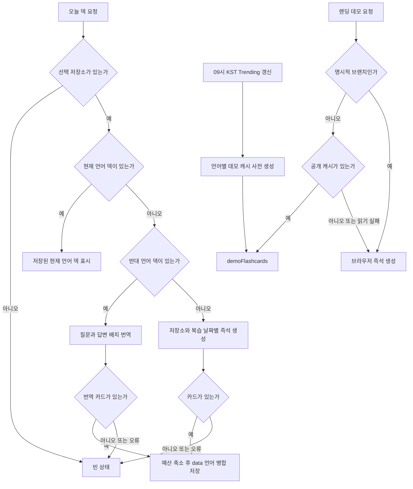

로그인 사용자의 오늘 카드와 랜딩 데모는 모두 GitHub 커밋을 질문·답변 카드로 바꾸지만, **캐시 우선순위·실행 주체·저장소**가 다르다. 사용자 화면은 날짜 문서의 현재 언어 덱을 먼저 읽고, 없으면 반대 언어 덱을 번역해 채우며, 둘 다 없을 때만 커밋과 AI를 호출한다. 랜딩은 Trending 기반의 공개 데모 캐시를 먼저 읽는다. 사용자 문서와 공개 캐시의 읽기·쓰기 경계는 [Firestore 데이터 경계](../architecture/firestore-data-boundary.md)를 참고한다.

## 오늘 덱의 복구 순서

`useTodayFlashcards`는 사용자 저장소가 없으면 즉시 빈 상태로 끝낸다. 저장소가 있으면 현재 표시 언어를 `ko` 또는 `en`으로 정하고, 시간대와 언어를 사용자 문서에 best-effort로 기록한다. 이 설정은 사용자별 사전 생성의 날짜와 언어 입력이다.



*저장된 현재 언어 덱, 반대 언어 번역, 즉석 생성, 빈 결과와 랜딩 데모 fallback의 우선순위다.*

1. 현재 언어의 `data_ko` 또는 `data_en` 배열이 비어 있지 않으면 생성하지 않는다. 기존 카드에 브랜치가 빠진 경우에만 기본 브랜치를 알아내어 같은 언어 필드를 보강 저장한다.
2. 현재 언어가 없고 반대 언어 덱이 있으면 `translateFlashcards`를 호출한다. GitHub을 다시 읽거나 카드를 새로 생성하지 않으며, 번역된 덱을 남은 문서 예산 안으로 줄여 현재 언어 필드에 병합한다.
3. 두 언어 덱 모두 없을 때만 Free는 1일·7일 전, Pro는 1일·7일·30일 전의 날짜를 저장소별로 순서대로 조사한다. 각 조합에서 변경 파일이 있는 첫 커밋을 골라 diff를 AI에 보내며, 한 조합의 실패는 로그만 남기고 다음 조합을 계속한다.
4. 결과 카드가 하나 이상일 때만 축소 후 저장한다. 번역 결과 또는 생성 결과가 비었거나 최상위 작업이 실패하면 날짜 키를 설정하지 않고 화면은 빈 상태가 된다.

공개 `openaiChatCompletions`는 입력을 검증하고 호출량을 먼저 차감한 뒤 모델 호출을 수행한다. 호출 한도와 선차감의 실패 의미는 [공개 AI 함수 호출 경계](../architecture/ai-call-guard.md)에 있다.

## 카드 및 날짜 덱 계약

날짜 문서 `users/{uid}/flashcards/{YYYY-MM-DD}`에는 두 독립 언어 필드 `data_ko`, `data_en`가 공존한다. 카드의 필수 본문은 `question`, `answer`이고, 선택 `highlights`와 `metadata`를 갖는다. `metadata`에는 커밋 메시지, `rawDiff`, 변경 파일, 저장소 전체 이름, 브랜치가 들어갈 수 있다. `rawDiff`는 diff 보기와 질문 재생성의 입력이며, 이를 저장 예산 때문에 제거하면 재생성 제어도 나타나지 않는다.

앱과 Functions는 별도 패키지이므로 다음 계약을 복제한다.

| 계약 | 동작과 변경 시 주의 |
|---|---|
| 복습 범위 | 앱 즉석 생성과 서버 사전 생성은 Free `[1, 7]`, Pro `[1, 7, 30]`을 사용한다. |
| 크기 예산 | 한 날짜 문서의 안전 상한은 900,000 bytes, 언어 덱 기본 예산은 450,000 bytes다. 두 언어가 한 문서에 있으므로 번역 경로는 반대 언어 덱 크기를 뺀 더 작은 예산을 쓴다. |
| 축소 방식 | `rawDiff`를 최대 30,000자에서 단계적으로 줄이고, 파일 목록은 최대 20개로 줄이며, 그래도 넘으면 diff 없이 저장한다. |
| 데모 캐시 ID | 공개 캐시는 `owner__repo__lang` 문서 ID를 앱과 Functions가 함께 사용한다. |

크기와 축소의 세부 계약은 [덱 문서 크기 예산](deck-size-budget.md)을 따른다. 이 표의 타입·날짜·상한을 한쪽만 바꾸면 언어 전환, 앱 즉석 생성, 서버 사전 생성이 같은 문서를 서로 다르게 해석한다.

## 즉석 생성과 사전 생성

두 경로는 **저장소와 복습 날짜에서 커밋 목록을 찾고, 상세 커밋에서 diff를 만들고, 구조화 AI 출력으로 카드를 만든다**는 같은 논리 단계를 따른다. 다만 앱 즉석 생성은 브라우저가 GitHub HTTP 함수와 `openaiChatCompletions`를 차례로 호출해 날짜를 브라우저 시간으로 계산하고, 생성 완료 후에만 직접 Firestore에 저장한다. 서버 사전 생성은 Functions 안에서 `flashcard-generation.ts`의 GitHub 조회·diff 구성·AI 생성 공용 함수를 사용하고 사용자 시간대 날짜를 계산한다. 즉 AI 생성 계약은 공통이지만, 실행 위치와 GitHub 호출 경계, 날짜 계산, 병렬성, 저장 시점은 같지 않다.

| 항목 | 앱 즉석 생성 | 사용자별 사전 생성 |
|---|---|---|
| 날짜와 순서 | 브라우저 현재 시각 기준으로 저장소 × 날짜를 순차 처리 | 사용자 IANA 시간대의 날짜 범위를 사용하고 저장소·날짜 조합을 병렬 처리하되 결과 순서는 저장소, 날짜 순으로 유지 |
| GitHub·AI 경계 | 앱의 GitHub 함수 호출과 공개 AI HTTP 함수를 조합 | 서버의 `fetchGitHub`, `fetchCommitDetail`, `formatCommitDiff`, `generateFlashcardItems`를 사용 |
| 저장 | 카드가 있으면 해당 언어 필드에 병합 저장 | 생성 전과 저장 트랜잭션 안에서 기존 덱을 확인한 뒤에만 저장 |
| 실패 | 조합 오류를 건너뛰고, 최종 빈 결과는 빈 화면 | 일부 실패로 전체가 비면 재시도하고, 커밋 없음과 설정 불가는 완료로 기록 |

공용 서버 생성은 토큰이 있으면 GitHub Bearer 인증을, 없으면 데모 User-Agent를 사용한다. 401은 `GitHubAuthError`로 구분한다. 기본 브랜치 조회의 일반 오류는 브랜치 없이 후속 조회를 계속하지만 인증 오류는 전파한다. 커밋 목록에는 파일 diff가 없으므로 상세 조회 후 `formatCommitDiff`가 커밋 메시지, 짧은 SHA, 파일 상태와 patch를 Markdown으로 구성한다.

모델 입력은 30,000자로 절단한다. Structured Outputs는 `items[].question`, `answer`, `highlights`를 요구하고, 파서는 문자열 질문·답변이 아닌 항목을 버리며 유효한 문자열 highlight만 남긴다. 따라서 JSON 파싱 실패나 빈 항목은 경로마다 카드 없음 또는 해당 조합 실패로 나타날 수 있다. 데모 사전 생성은 커밋당 첫 카드만 사용한다.

### 사용자별 사전 생성과 경합

매시 정각 스케줄러는 언어·유효한 시간대·저장소 설정이 있고 최근 7일 활동한 사용자 중 현지 시각 0시 이상 6시 미만인 대상을 Cloud Tasks에 넣는다. 같은 날짜를 끝낸 사용자는 서버 전용 `flashcardPregeneration/{uid}` 기록으로 건너뛴다. 태스크와 다음 스케줄 시각의 재시도, 완료 상태의 자세한 의미는 [오늘의 플래시카드 사전 생성](pregeneration.md)에 있다.

작업은 어느 언어든 비어 있지 않은 덱이 이미 있으면 생성 전에 포기하고 `exists`를 기록한다. 생성 도중 앱이 먼저 저장할 수 있으므로, 실제 저장도 트랜잭션에서 다시 확인한다. 이 이중 확인은 사전 생성이 앱의 덱을 덮어쓰지 않는 불변식이다.

완료 기록의 결과는 `saved`, `exists`, `empty`, `unavailable`이다. GitHub 토큰 무효 또는 필요한 설정 누락은 `unavailable`, 실패한 조합 없이 카드가 없으면 `empty`로 확정한다. 반대로 일시 오류나 일부 조합 실패 때문에 덱이 비면 완료 기록 없이 오류를 던져 태스크와 새벽 구간의 다음 스케줄이 다시 시도하게 한다.

## 랜딩 데모 경로

매일 09:00 KST `refreshTrendingRepos`는 GitHub Trending을 최대 10개까지 수집한다. 파싱 결과가 5개 미만이면 기존 Trending 목록과 데모 카드를 유지한다. 충분하면 먼저 `meta/trendingRepos`를 갱신하고, 이어서 저장소별·`ko`/`en`별로 기본 브랜치 최근 세 커밋의 카드를 생성한다. 카드 생성 실패는 이미 저장한 Trending 목록을 되돌리지 않는다.

데모 사전 생성은 저장소를 순차 처리하고 저장소 안의 커밋은 병렬 처리한다. 커밋당 첫 카드 한 장만 저장하며, 카드 뒷면용 파일은 최대 10개, 각 patch는 최대 4,000자로 제한한다. 직렬화 문서가 900,000 bytes를 넘으면 그 언어 캐시를 저장하지 않고, 이번 Trending 목록에서 빠진 캐시는 삭제한다.

랜딩의 `useDemoFlashcards`는 기본 브랜치 URL일 때만 공개 캐시를 읽는다. 캐시가 없거나 읽기가 실패하거나 URL에 `@branch`가 있으면 `generateDemoFlashcards`로 대체한다. 이 브라우저 fallback은 공개 GitHub API에서 최근 세 커밋과 상세를 읽고 AI HTTP 함수를 호출하며 Firestore에는 쓰지 않는다. AI가 커밋별 카드 생성을 실패하면 이 fallback만의 평문 질문·답변을 만들어 세 카드의 표시를 계속한다.

## 번역과 질문 재생성

`translateFlashcards`는 최대 200장의 `question`·`answer`만 배열로 보내고, 응답 인덱스를 원래 카드에 붙인다. 따라서 `highlights`와 `metadata`는 보존되며, 응답 수가 맞지 않는 위치는 원문 질문·답변을 유지한다. 카드 수 또는 직렬화 본문이 상한을 넘으면 대응 관계가 깨지는 절단 대신 413으로 거부한다.

질문 재생성은 `rawDiff`, 기존 질문·답변, 최대 10개의 다른 질문을 입력으로 새 `question`과 `highlights`만 돌려준다. 로그인 카드 화면은 이를 현재 언어의 오늘 날짜 덱에 병합 저장한다. 랜딩 데모는 `replaceCards`로 React Query 캐시만 바꾸므로 공개 `demoFlashcards` 문서는 수정하지 않는다.

재생성 버튼의 잠금과 서버 한도는 별개다. 카드 UI는 `rawDiff`가 있을 때만 버튼을 보이고, 현재 요청 중인 카드만 `regeneratingIndex`로 비활성화한다. 로그인 화면의 `useRegenerateQuota`는 서버 전용 `regenerateCounts`를 구독해 `canRegenerate`가 거짓이면 요청을 시작하지 않는 **표시·사전 차단**이다. 그러나 실제 한도 검사는 서버가 KST 날짜 기준으로 Free 3회, Pro 20회, 비로그인 데모 1회를 적용하여 429를 반환하는 것으로 결정된다. 네트워크 지연, 여러 화면, 직접 요청 또는 UI 상태 불일치 때문에 UI가 열려 있어도 서버 오류와 429를 처리해야 하며, 성공한 AI 응답 뒤에만 서버 카운터가 증가한다.

## 변경과 운영 점검

- 카드 형식, 프롬프트·응답 스키마, diff 길이 또는 덱 예산을 바꿀 때는 앱 타입, 앱 축소기, Functions 축소기, 번역의 인덱스 보존, 재생성 입력을 함께 검토한다.
- 날짜·시간대 또는 사전 생성 동시성을 바꿀 때는 앱과의 경합, 두 번의 기존 덱 확인, 빈 결과와 부분 실패의 구분을 확인한다.
- 데모 캐시를 바꿀 때는 5개 미만 Trending 결과가 기존 캐시를 보존하는지, 캐시 읽기 실패와 `@branch`가 fallback하는지, 큰 문서가 저장되지 않는지를 확인한다.
- 재생성 변경은 UI의 요청 중 잠금과 별도로 서버 429·인증·AI 오류가 사용자에게 표시되는지, 로그인 저장과 데모의 메모리 캐시 갱신이 섞이지 않는지를 확인한다.
- 현재 `app/` 및 `functions/`에는 테스트 파일이 없다. 계약 변경에는 malformed JSON·빈 `items`, 번역 길이 불일치와 413, 덱 예산 경계, 사전 생성 트랜잭션 경합, 캐시 hit/miss와 `@branch` 우회, 재생성 429를 다루는 fixture 단위 테스트 또는 Emulator 테스트를 추가하는 것이 안전하다.

```bash
pnpm --prefix functions run lint
pnpm --prefix functions run build
```
