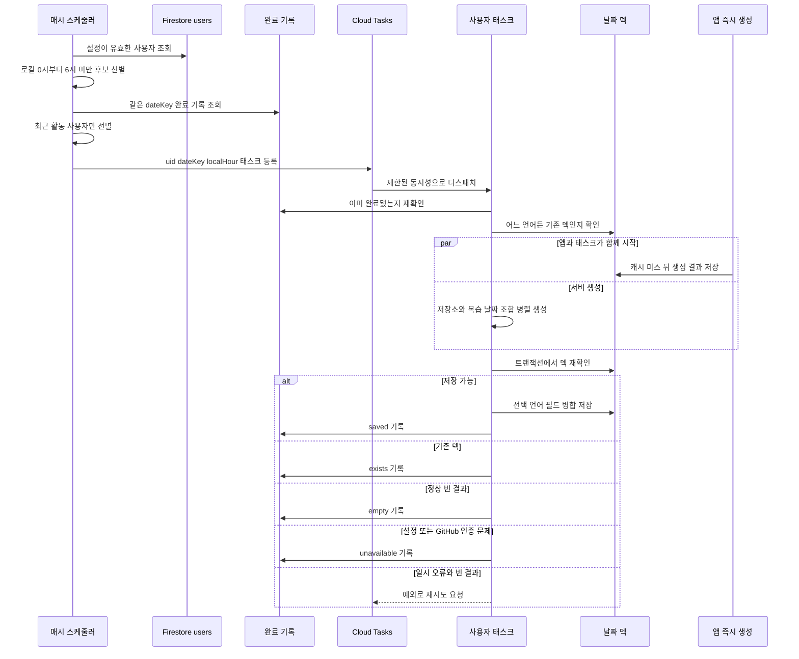

## 목적과 경계

`useTodayFlashcards`는 먼저 `users/{uid}/flashcards/{YYYY-MM-DD}`에서 현재 표시 언어의 덱을 읽는다. 없으면 반대 언어 덱을 현재 언어로 번역하고, 둘 다 없을 때만 브라우저가 GitHub 조회와 AI 생성을 수행한다. 사전 생성은 이 마지막 캐시 미스의 대기 시간을 줄이기 위해 같은 날짜 문서를 미리 채우는 서버 경로다. 대상이 아니거나 사전 생성에 실패해도 앱의 즉시 생성 경로는 계속 동작한다. 언어 전환과 생성의 상세한 우선순위는 [카드 생성 경로](generation-paths.md)를 참고한다.

날짜 문서 ID와 카드 언어는 사용자의 기기 설정과 반드시 같아야 한다. 앱은 열릴 때 브라우저가 해석한 IANA 시간대와 현재 표시 언어(`ko` 또는 `en`)를 `users/{uid}`에 best-effort로 기록하며, 값이 이미 같으면 쓰지 않는다. 서버는 유효한 이 두 값으로 로컬 `dateKey`, 새벽 창, 카드 언어를 결정한다. 동기화가 되지 않은 사용자에게 언어 또는 시간대를 추정해 덱을 만들지 않는 이유다.

생성 대상 커밋은 `dateKey`보다 1일·7일 전 또는 등급에 따라 30일 전의 **사용자 로컬 달력일**에서 찾는다. 따라서 현지 자정이 지나야 전날의 커밋 범위가 확정된다. 서버의 `Intl` 기반 날짜 범위는 그 로컬 날짜의 자정부터 다음 자정 직전까지이며, 오프셋을 각 자정 부근에서 계산해 서머타임 전환일도 처리한다. 자정 이전에 생성하면 아직 진행 중인 전날을 확정된 입력처럼 조회하게 되므로, 사전 생성 창은 로컬 0시부터 시작한다.

- **날짜 덱:** 서버는 `data_ko` 또는 `data_en` 한 필드만 병합 저장한다. 어느 언어든 비어 있지 않은 덱이 있으면 생성하지 않으며, 다른 언어를 채우는 일은 앱 번역 경로의 책임이다.
- **완료 기록:** `flashcardPregeneration/{uid}`는 날짜별 작업이 확정적으로 끝났음을 나타내는 서버 전용 문서다. 이 컬렉션은 Firestore 규칙에 `match`가 없어 클라이언트가 읽거나 쓰거나 삭제할 수 없다. 경계의 배경은 [Firestore 데이터 경계](../architecture/firestore-data-boundary.md)를 참고한다.
- **공유 데이터 계약:** Free는 `[1, 7]`, Pro는 `[1, 7, 30]`일 전을 대상으로 한다. 저장 전 `fitFlashcardDeckToBudget`이 카드 메타데이터와 원문 diff를 줄여 덱 예산에 맞춘다. 앱과 Functions가 별도 패키지이므로 복습 간격·카드 구조·축소 정책을 함께 변경해야 한다. 자세한 제한은 [덱 문서 크기 예산](deck-size-budget.md)에 있다.

## 예약부터 저장까지

`functions/src/index.ts`는 `scheduleFlashcardPregeneration`과 `pregenerateUserFlashcards`를 내보낸다. 전자는 `asia-northeast3`에서 매시 정각에 후보만 골라 Cloud Tasks에 넣고, 후자는 사용자 한 명의 GitHub·AI 작업과 저장을 수행한다. 스케줄러 자체도 등록 실패 시 재시도하도록 구성되어 있으며, 결정적 태스크 ID가 그 재실행을 안전하게 만든다.



*후보 선정, 큐 예약, 앱과 서버의 저장 경쟁, 완료 및 재시도 분기를 보여 준다.*

### 후보 선정과 중복 예약

스케줄러는 `language in ["ko", "en"]`인 `users` 문서에서 `timezone`, `language`, `repositories`만 읽은 뒤 다음 조건을 모두 적용한다.

1. 시간대가 런타임이 인식하는 IANA 값이고, 언어가 `ko` 또는 `en`이며, 선택 저장소가 하나 이상이어야 한다.
2. 스케줄 시각을 해당 시간대로 변환한 로컬 시가 0 이상 6 미만이어야 한다. 이 창은 특정 자정을 놓친 경우에도 다음 정각에 따라잡을 기회를 제공한다.
3. `flashcardPregeneration/{uid}`의 `dateKey`가 후보의 로컬 오늘과 같으면 제외한다. 완료 기록은 사용자당 한 문서이며, 조회는 묶어서 수행한다.
4. Auth 메타데이터의 `lastRefreshTime`을 우선하고 없으면 `lastSignInTime`을 사용해 최근 7일 안에 활동한 사용자만 남긴다.

태스크 본문은 `uid`, `dateKey`, `localHour`이고 ID는 `${uid}-${dateKey}-h${localHour}`다. 같은 정각의 중복 enqueue는 `functions/task-already-exists`로 건너뛴다. 다음 정각에는 ID가 달라지므로 미완료 사용자는 다시 예약할 수 있다. enqueue 하나라도 실패하면 스케줄러가 예외를 던져 자체 재시도하며, 이미 들어간 작업은 같은 ID 때문에 중복되지 않는다.

## 사용자 태스크의 생성과 경쟁 제어

태스크는 먼저 완료 기록을 다시 읽는다. 이전 시각의 태스크가 늦게 끝난 뒤 다음 시각의 태스크가 도착하는 경우를 막기 위해서다. 그 다음 사용자 설정과 GitHub 토큰을 읽는다. 설정 또는 토큰이 없으면 재시도로 해소되지 않는 상태로 보고 `unavailable`을 기록하고 종료한다.

생성은 저장소별로 병렬 실행하고, 각 저장소 안에서는 복습 날짜별로 병렬 실행한다. 설정된 브랜치가 없으면 기본 브랜치를 조회하며, 일반적인 기본 브랜치 조회 실패는 브랜치 없이 GitHub 기본값을 사용해 계속한다. 각 조합은 로컬 날짜 범위에서 변경 파일이 있는 첫 커밋을 선택하고, 상세 커밋의 diff를 공용 `generateFlashcardItems`에 전달한다. GitHub 401은 일반 오류와 달리 `GitHubAuthError`로 구분한다. GitHub 요청과 구조화된 AI 출력의 공용 계약은 [카드 생성 경로](generation-paths.md)를 참고한다.

일반 읽기는 불필요한 생성 호출을 피하고, 트랜잭션의 재검사는 앱과의 경쟁에서 데이터 손실을 막는다. `hasDeck`은 `data_ko`와 `data_en` 중 하나라도 비어 있지 않은 배열인지 검사한다.

- 일반 읽기에서 기존 덱을 찾으면 AI 호출 없이 `exists`를 기록한다.
- 생성 결과가 있으면 예산에 맞춘 뒤 트랜잭션에서 다시 `hasDeck`을 검사한다. 여전히 비어 있을 때만 선택 언어 필드를 `{merge: true}`로 저장하고 `saved`를 기록한다.
- 트랜잭션 사이에 앱이 먼저 저장하면 서버는 쓰지 않고 `exists`를 기록한다. 즉 서버는 앱이 만든 어느 언어 덱도 덮어쓰지 않는다.

## 완료 기록과 실패 의미

덱 문서가 없다는 것은 카드가 될 커밋이 없었다는 뜻일 수도, 아직 처리하지 않았거나 실패했다는 뜻일 수도 있다. 이 둘을 분리하려고 확정된 경우에만 완료 문서에 `{ dateKey, outcome, updatedAt }`를 쓴다.

| `outcome` | 확정 의미 | 이후 스케줄 |
|---|---|---|
| `saved` | 서버가 축소한 카드 덱을 저장함 | 같은 날짜 후보에서 제외 |
| `exists` | 앱 또는 다른 경로가 비어 있지 않은 덱을 먼저 저장함 | 같은 날짜 후보에서 제외 |
| `empty` | 모든 조합이 정상 완료됐지만 카드가 없음 | 같은 날짜 후보에서 제외 |
| `unavailable` | 설정·토큰 부재 또는 유효하지 않은 GitHub 토큰 | 같은 날짜 후보에서 제외 |

빈 결과의 처리는 오류 원인에 따라 다르다.

- 조합별 일반 오류는 기록하고 다른 조합을 계속 처리한다. 전체 결과가 비어 있고 실패 조합도 없을 때만 `empty`로 완료한다.
- 일부 조합이 실패한 채 결과가 비면, 실패한 조합에 카드가 될 커밋이 있었을 수 있다. 완료 기록 없이 예외를 던져 Cloud Tasks 재시도 및 다음 정각의 재예약 대상이 되게 한다.
- GitHub 인증 오류와 설정·토큰 누락은 재시도로 해결되지 않는 것으로 간주하여 `unavailable`으로 완료한다.
- 카드가 하나라도 생성되면 일부 조합이 실패했어도 사용 가능한 덱을 저장하고 `saved`로 완료한다. 따라서 **부분 실패와 빈 결과의 조합만** 미처리 상태로 남긴다.

Cloud Tasks 태스크는 최대 3회, 최소 120초 backoff로 재시도한다. 태스크 재시도가 모두 소진되어도 완료 기록이 없으므로, 사용자의 로컬 새벽 창이 남아 있으면 다음 정각 스케줄러가 새 ID로 다시 예약할 수 있다.

## 운영과 안전한 변경

- 앱의 시간대·언어 동기화는 best-effort `updateDoc`이다. `users` 규칙은 이 필드를 클라이언트 쓰기 허용 목록과 형식 검증에 포함한다. 필드명 또는 언어 집합을 바꾸면 앱, 규칙, `readPregenerationSettings`를 함께 바꾼다.
- 태스크 큐의 최대 동시 디스패치는 5개이고, 전역 Functions 인스턴스 상한은 10개다. 한 태스크가 저장소와 날짜 조합을 병렬 처리하므로, 이 동시성은 모델 호출 속도 제한을 조절하는 경계다. 상한을 올리면 동시에 발생하는 모델 호출도 늘어나며, 낮추면 새벽 창 안의 완료율과 재시도 누적에 영향을 준다. 큐 상한·인스턴스 상한·태스크 내부 병렬성을 독립적으로 변경하지 않는다.
- 함수 timeout은 540초다. 저장소 수, 복습 간격, 모델 응답 시간 또는 동시성 상한을 조정할 때는 이 실행 한계와 새벽 창 내 처리량을 함께 검토한다.
- 큐 경로에 쓰는 `pregenerateUserFlashcards` 이름은 export 이름과 일치해야 한다. 리전 또는 함수 이름을 바꾸면 예약 측과 디스패치 측을 함께 변경한다.

```bash
pnpm --prefix functions run lint
pnpm --prefix functions run build
```

전용 테스트 파일은 현재 없다. 이 워크플로를 변경할 때는 Emulator 또는 의존성 mock으로 다음을 검증하는 테스트를 추가하는 것이 좋다: 시간대 경계와 서머타임 날짜 범위, 최근 활동 및 완료 사용자 제외, 결정적 태스크 ID의 멱등 예약, 앱 저장과 트랜잭션 저장의 경쟁, `empty`와 부분 실패의 구분, GitHub 401의 `unavailable`, 예외가 완료 기록 없이 재시도되는 경로.
