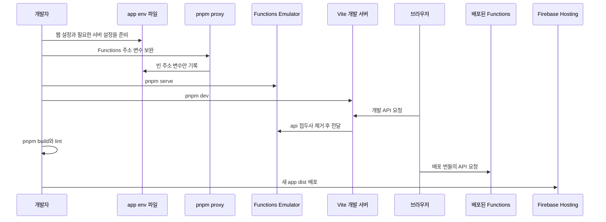

# 로컬 개발·검증·배포

이 저장소는 pnpm 워크스페이스의 `app`과 `functions`를 독립적으로 빌드한다. `app`은 Vite 브라우저 번들과 정적 문서를 만들고, `functions`는 Firebase Cloud Functions 배포물을 만든다. 개발에서는 브라우저의 API 요청이 Vite 프록시를 거쳐 Functions Emulator로 가지만, 배포 번들은 Functions 공개 URL을 직접 호출한다. 이 차이와 Hosting의 산출물 경계를 지키지 않으면, 로컬에서는 동작해도 오래된 URL 또는 오래된 정적 파일을 배포할 수 있다.



*개발 요청은 Vite를 거쳐 Emulator로 가고, 배포용 요청 주소와 Hosting 파일은 빌드 결과에 의해 결정되는 흐름이다.*

## 시작 전: 로컬 파일과 Firebase 선택

Node.js 22 이상, pnpm, Firebase CLI가 필요하다. 루트에서 의존성을 설치한다.

```bash
pnpm install
```

환경 파일과 Firebase 선택은 저장소에 커밋되지 않는다. `app/.env`에는 Firebase 웹 SDK 설정과 Functions 주소 생성의 입력을, `functions/.env`에는 서버 측 AI 제공자 인증 정보를 둔다. `.env`와 `.firebaserc`는 Git 무시 대상이므로 값·키·운영 프로젝트 정보를 문서, 로그, 스크린샷, 커밋에 남기지 않는다.

`app/.env`는 예시 파일에서 만든다.

```bash
cp app/.env.example app/.env
```

| 환경 변수 | 용도 |
| --- | --- |
| `VITE_API_KEY`, `VITE_AUTH_DOMAIN`, `VITE_PROJECT_ID`, `VITE_STORAGE_BUCKET`, `VITE_MESSAGING_SENDER_ID`, `VITE_APP_ID`, `VITE_MEASUREMENT_ID` | 브라우저 Firebase 앱의 웹 설정 |
| `VITE_VAPID_KEY` | 웹 푸시 등록에 쓰는 공개 설정 |
| `VITE_CLARITY_PROJECT_ID` | 선택적인 브라우저 분석 연동 설정 |
| `VITE_FIREBASE_PROJECT_ID`, `VITE_FIREBASE_REGION`, `VITE_FUNCTIONS_URL_LOCAL`, `VITE_FUNCTIONS_URL_PROD` | `pnpm proxy`가 보완하는 Functions 주소 구성 정보 |
| `OPENAI_API_KEY` | Functions가 AI 제공자를 호출할 때 사용하는 서버 측 인증 정보 |

Firebase CLI 로그인 후 이 작업 사본에서 쓸 프로젝트를 선택하고 확인한다.

```bash
firebase login
firebase use --add
firebase use
```

`firebase init`은 실행하지 않는다. 이 저장소는 이미 `firebase.json`, Firestore 규칙, Functions 소스와 배포 구성을 소유한다. 초기화 마법사를 다시 실행하면 이 기존 구성을 변경하거나 덮어쓸 수 있으므로, 프로젝트 연결에는 `firebase use --add`를 사용한다.

`.firebaserc`는 무시되며 워크트리에 복사되지 않는다. Orca가 만드는 워크트리는 `.worktreeinclude`에 따라 `app/.env`와 `functions/.env`를 기본 체크아웃에서 복사할 수 있지만, Firebase CLI의 활성 프로젝트 선택은 복사하지 않는다. 따라서 새 clone뿐 아니라 **각 worktree마다** `firebase use --add`를 실행하고 `firebase use`로 배포 대상을 확인해야 한다.

## 주소 계약: `pnpm proxy`와 빌드 시점 Functions URL

루트 `pnpm proxy`는 `scripts/setup-proxy.js`를 실행한다. 이 스크립트는 `app/.env`의 `VITE_PROJECT_ID`를 읽어 Functions 관련 변수들을 만든다. 파일 또는 해당 프로젝트 ID가 없으면 실패한다. 이미 비어 있지 않은 값은 보존하고, 누락했거나 빈 키만 채운다. 프로젝트 또는 리전을 바꾼 뒤에는 기존 주소가 자동으로 교체된다고 가정하지 말고, 값이 의도한 대상과 맞는지 검토한다.

Vite 설정은 개발 모드의 `/api` 프록시 대상을 로컬 Functions URL로 선택하며 `/api` 접두사를 제거한다. 반면 API 모듈은 개발 중 `/api`를 기본 URL로, 프로덕션에서는 `VITE_FUNCTIONS_URL_PROD`를 기본 URL로 사용하여 함수 경로를 붙인다. `VITE_*` 값은 Vite가 번들을 만들 때 읽으므로 Functions URL은 실행 중에 다시 발견되는 설정이 아니라 **브라우저 번들에 인라인되는 빌드 시점 계약**이다.

따라서 주소, 프로젝트 또는 리전을 바꾸거나 API URL 계약을 바꾼 경우에는 다음 순서를 지킨다.

1. `app/.env`의 입력 및 Functions 관련 변수의 대상이 의도와 맞는지 확인한다.
2. `pnpm proxy`로 누락되거나 빈 변수를 보완한다.
3. 개발 확인을 위해 Vite를 재시작하고, 배포할 경우 `pnpm build`로 새 번들을 만든다.
4. 이미 배포된 Hosting 파일에는 이전 URL이 남을 수 있으므로 Functions만 재배포해서 브라우저의 호출 대상을 바꿀 수 없음을 확인한다.

Functions URL은 공개 주소이며 비밀이나 권한 부여 수단이 아니다. HTTP 함수의 인증·입력 검증·호출량 제한은 [공개 AI 함수 호출 경계](../architecture/ai-call-guard.md)에서 다룬다.

## 로컬 개발: Functions와 Vite의 책임 분리

서로 다른 터미널에서 다음 명령을 실행한다.

```bash
pnpm proxy
pnpm serve
```

```bash
pnpm dev
```

| 루트 명령 | 연결되는 패키지 또는 대상 | 역할 |
| --- | --- | --- |
| `pnpm proxy` | `scripts/setup-proxy.js`, `app/.env` | 프로젝트 ID를 바탕으로 Functions 주소 관련 변수를 보완 |
| `pnpm serve` | `functions`, Firebase Functions Emulator | Functions를 빌드한 뒤 Functions Emulator만 시작 |
| `pnpm dev` | `app` | Vite 개발 서버 실행 |
| `pnpm build` | `app`, `functions` | 모든 워크스페이스의 build 실행 |
| `pnpm push` | Firebase CLI | 현재 Firebase 선택으로 전체 배포 실행 |

`pnpm serve`는 Functions 빌드 뒤 `--only functions`로 Emulator를 시작한다. 따라서 Firestore, Authentication, Hosting Emulator는 시작하지 않는다. 또한 앱의 Firebase 초기화는 웹 설정으로 Auth와 Firestore 클라이언트를 만들지만 Emulator 연결 코드를 호출하지 않는다. 로컬 앱의 Firestore 읽기·쓰기는 선택한 Firebase 프로젝트의 데이터와 규칙에 영향을 줄 수 있으므로, 안전한 테스트 프로젝트를 선택해 작은 범위에서 확인한다.

Functions가 준비된 뒤 Vite를 시작하고 화면에서 API 요청을 확인한다. Functions의 AI 경로는 `functions/.env`의 `OPENAI_API_KEY`가 없으면 요청을 성공시킬 수 없다. 키의 존재와 요청 실패 경로만 확인하고 그 값은 노출하지 않는다. GitHub 연동 변경은 [GitHub 인증과 커밋 조회 경계](../integrations/github-access.md), 브라우저 푸시는 [시간대 기반 푸시 알림](push-notifications.md)을 함께 확인한다.

## 빌드·검증: 실제 경계

`app`의 build는 TypeScript 검사와 Vite 빌드를 수행해 `app/dist`를 만들고, `functions`의 build는 TypeScript 컴파일 결과를 만든다. 루트 `pnpm build`는 두 워크스페이스의 build를 모두 실행한다.

```bash
pnpm build
pnpm --filter functions lint
```

현재 자동화된 테스트 스위트는 없다. 따라서 기여 가이드가 정한 실제 검증 경계는 다음 세 가지다.

1. `pnpm build`로 전체 타입 검사와 두 빌드가 성공하는지 확인한다.
2. `pnpm --filter functions lint`로 Functions ESLint를 통과하는지 확인한다.
3. 화면 변경은 `pnpm dev`에서 직접 확인하고, 변경한 API·인증·규칙·알림 등 경계의 정상 및 실패 경로를 수동으로 점검한다.

수동 확인 결과는 PR에 남긴다. 기본 로컬 시작과 변경 유형별 상세 경로는 [변경 길잡이](../quickstart.md)를 참고한다.

## 배포: Functions·규칙과 Hosting 산출물

Firebase 설정은 Functions 배포 전에 Functions TypeScript build를 실행하며 Firestore 규칙 파일도 배포 대상으로 둔다. Functions 진입점은 Admin 앱을 초기화하고 HTTP·스케줄·태스크 관련 모듈을 export하며, 전체 Functions에 최대 인스턴스 제한을 적용한다. Functions 변경은 HTTP 요청뿐 아니라 다음 스케줄 또는 태스크 실행 시점에 관찰될 수 있으므로 트리거 종류에 맞춰 확인한다.

반면 Hosting의 public 디렉터리는 `app/dist`이며 Hosting predeploy에는 Vite build가 없다. 즉 `firebase deploy --only hosting`과 `pnpm push`는 프런트엔드를 빌드하지 않고 현재 존재하는 `app/dist`를 올린다. `app/dist`와 Functions 컴파일 출력은 Git 무시 생성물이므로, 특히 새 clone에서는 빌드 없이 Hosting을 배포하지 않는다.

> Hosting 배포 전에는 현재 검토한 환경 변수로 `pnpm build`를 성공시켜, 새 `app/dist`가 존재하도록 해야 한다.

이를 생략하면 배포가 실패할 수 있으며, 더 위험하게는 남아 있던 산출물이 있으면 이전 코드·정적 파일·Functions URL을 배포할 수 있다. API의 브라우저 호출 주소 또는 응답 계약이 바뀌면 Functions뿐 아니라 새 Hosting 번들도 배포한다.

Vite는 랜딩, 앱, 약관, 개인정보와 각 영문 문서를 다중 입력으로 빌드한다. Hosting은 `/app`과 `/app/**`를 `app.html`로 rewrite하고, `/terms`와 `/privacy`는 각 정적 문서로 보낸다. 라우트 또는 엔트리를 바꿨다면 배포 뒤 루트, `/app`, 앱 하위 경로 새로고침, 약관과 개인정보 경로를 확인한다.

### 권장 배포 순서

서버 측 계약과 클라이언트 산출물을 분리해 확인한다.

```bash
firebase use
pnpm proxy
pnpm build
pnpm --filter functions lint
firebase deploy --only functions,firestore:rules
firebase deploy --only hosting
```

Functions와 규칙을 함께 바꿨다면 먼저 서버 측 단위를 배포한 뒤 검증한 Hosting 산출물을 올린다. 전체 배포가 필요하면 마지막 단계 대신 다음을 쓸 수 있지만, 이 명령도 빌드를 대신하지 않는다.

```bash
pnpm push
```

배포 후에는 활성 프로젝트가 의도한 대상이었는지, 새 Hosting 경로가 맞는 문서를 제공하는지, 그리고 브라우저 네트워크 요청이 새 번들이 가리키는 Functions 대상으로 가는지를 확인한다. 시스템 전체 책임 배치는 [시스템 구성](../architecture/system-overview.md)을 참고한다.
