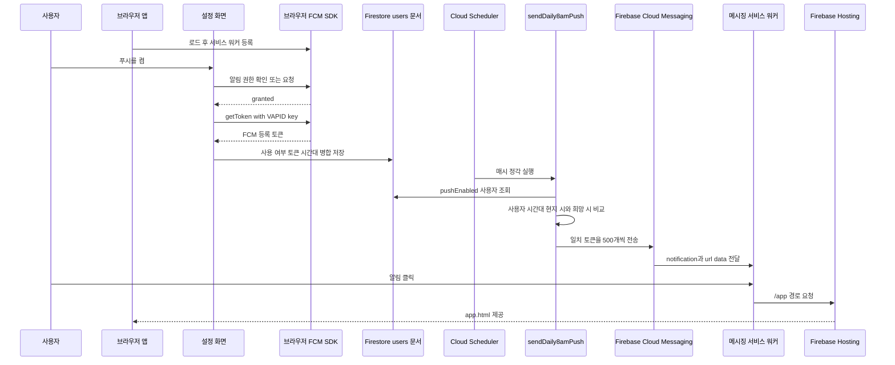

# 푸시 알림과 정기 정리 작업

이 기능은 브라우저가 FCM 등록 토큰과 알림 설정을 `users/{uid}`에 보관하고, Cloud Functions가 매시 사용자별 현지 시각을 판정해 리마인더를 보내는 구조다. 전송은 클라이언트가 아니라 Admin SDK를 쓰는 `sendDaily8amPush`가 수행한다. 같은 스케줄 모듈은 탈퇴 기록을 짧게 보관하여 당일 재가입 확인을 지원하고, 다음날에는 정리한다.

## 등록부터 클릭까지

*브라우저 등록, 사용자별 시간대 판정, FCM 배치 전송, 그리고 `/app` 클릭 목적지의 경로 계약을 나타낸다.*

앱은 페이지 로드 후 `/firebase-messaging-sw.js` 등록을 시도하지만 등록 실패를 무시한다. 따라서 이 실패는 설정 화면에 별도 오류로 표시되지 않는다. 예약 메시지는 `type: "daily-reminder"`, `url: "/app"` 데이터를 포함한다. Hosting은 `/app` 및 `/app/**`를 `app.html`로 rewrite하므로, 클릭 경로는 랜딩(`/`)이 아닌 앱 진입점이어야 한다.

## 설정과 문서 경계

로그인한 사용자가 푸시를 켜면 설정 화면은 `Notification` API 지원 여부를 확인하고, 권한이 `default`일 때만 권한을 요청한다. 결과가 `granted`가 아니면 설정을 저장하지 않는다. 허용된 경우에만 동적으로 불러온 `firebase/messaging`의 `getToken()`을 호출한다. `VITE_VAPID_KEY`가 있으면 이를 전달하며, 빈 토큰은 실패로 처리한다.

성공 시 `setDoc(..., { merge: true })`는 `pushEnabled: true`, `fcmToken`, `preferredPushTimezone`, `updatedAt`을 병합한다. 이미 저장된 `preferredPushTimezone`이 있으면 이를 유지하고, 없을 때만 브라우저 `Intl.DateTimeFormat()`의 시간대를 쓴다. 반대로 끌 때는 `pushEnabled: false`와 갱신 시각만 쓴다. **토큰은 자동 삭제되지 않으며**, 다음에 켤 때 새 토큰으로 덮어쓸 뿐이다.

`users/{uid}`는 본인만 읽고 쓸 수 있다. 규칙은 클라이언트 쓰기 필드를 제한하고, `pushEnabled`는 boolean, `fcmToken`은 최대 1,024자 문자열, `preferredPushHour`는 0–23의 number, `preferredPushTimezone`은 최대 64자 문자열로 검사한다. 시간대 문자열이 실제 IANA 시간대인지 규칙에서 검증하지는 않는다. 사용자 문서의 소유권과 서버 전용 상태의 분리는 [Firestore 데이터 경계](../architecture/firestore-data-boundary.md)를 참고한다.

### 기본 시간대와 희망 시각

기본 희망 시각은 **08시**다. 설정 화면은 `preferredPushHour`가 숫자가 아니면 8로 표시하고, 스케줄 함수도 숫자가 아니면 8로 해석한다. 서버는 시간대가 문자열이 아니거나 빈 문자열이면 `Asia/Seoul`을 쓴다. 즉 두 설정이 없는 기존 문서는 서울 시간 08시에 전송 후보가 된다.

희망 시각 선택기는 Pro 사용자에게만 표시되며 0–23시를 저장한다. 값을 바꿀 때는 당시 브라우저 시간대도 함께 `preferredPushTimezone`에 쓴다. 토큰을 다시 등록하는 경로는 기존 시간대를 우선하므로, 기기 시간대 변경만으로 저장된 시간대가 갱신된다고 볼 수 없다.

## 매시 발송과 실패 의미

`sendDaily8amPush`는 `asia-northeast3`에서 cron `0 * * * *`로 실행된다. Scheduler 설정의 `Asia/Seoul`은 트리거의 기준 시간대이며, 사용자의 전달 시간대를 서울로 고정하지 않는다. 함수는 Scheduler가 제공한 시각(없으면 실행 시각)을 기준으로 `pushEnabled == true` 문서를 조회하고, 각 문서의 IANA 시간대 현지 시가 희망 시각과 같은 문자열 토큰만 고른다. `getHourInTimezone()`은 런타임이 자정을 24로 표현하는 경우 0으로 정규화한다.

대상이 없으면 로그를 남기고 정상 종료한다. 대상이 있으면 같은 notification/data payload를 가진 메시지를 최대 500개씩 나누어 `messaging.sendEach()`로 **순차** 전송한다. 사용자 문서에는 단일 `fcmToken` 필드만 있고 토큰 중복 제거도 하지 않으므로, 다중 기기 토큰 집합이나 문서 간 중복 전송 방지는 이 모델의 책임이 아니다.

### 실패는 기록하고 끝낸다

응답 안의 실패는 토큰의 배치 인덱스와 오류 메시지로 경고 로그를 남기고, 마지막에 성공·실패 합계를 기록한다. 실패·무효 토큰을 Firestore에서 제거하거나 `pushEnabled`를 끄지 않는다. 따라서 실패 토큰도 다음 매시 실행에서 다시 후보가 될 수 있다.

함수 전체는 하나의 `try/catch`로 감싸져 있다. 잘못된 시간대가 `Intl`에서 예외를 일으키거나 `sendEach()`가 reject하면 이후 판정·배치를 계속하지 않고 오류를 로그로 남긴 뒤 반환한다. 이 구현은 재시도 큐, 영속적 실패 이력, 정확히 한 번의 전달을 제공하지 않으며, 함수 자체가 오류를 다시 던져 Scheduler 재시도를 요구하지도 않는다.

운영 개선으로 무효 토큰 정리나 재시도를 도입한다면 오류 코드를 분류하고, 사용자 설정과 분리된 서버 전용 상태에 최소한의 식별자·집계만 기록한다. 원문 토큰을 로그나 운영 문서에 남기지 않는다.

## 탈퇴 기록의 수명과 정리

계정 탈퇴 흐름은 먼저 `deletedUsers/{uid}` 기록을 만들고, 사용자 문서와 하위 플래시카드를 지운 뒤 Auth 계정을 마지막에 삭제한다. 로그인 뒤에는 같은 UID의 탈퇴 기록을 확인한다. 기록의 탈퇴일이 **로그인 브라우저의 로컬 달력상 오늘**과 같으면 즉시 로그아웃하고 재가입을 막는다. 날짜가 다르면 로그인 코드는 그 기록 삭제를 시도한다.

그러나 Firestore 규칙은 `deletedUsers/{uid}`에 소유자의 읽기와 생성만 허용하고 클라이언트 삭제는 허용하지 않는다. 이 삭제 시도가 실패하면 오류를 로그로 남기되 로그인은 계속한다. 따라서 만료 기록의 실제 정리는 클라이언트 로그인 경로가 아니라 아래 서버 작업에 의존한다.

`cleanupDeletedUsers`는 `asia-northeast3`에서 매일 `Asia/Seoul` 기준 정오에 실행된다. 모든 탈퇴 기록을 읽어 KST 날짜가 오늘인 기록만 보존하고, 그 밖의 기록은 하나의 Firestore batch로 삭제한다. 이는 당일 기록을 유지하고 다음날 정리하는 수명 규칙이다. 날짜 판단 기준은 로그인 차단에서는 사용자의 로컬 시간대, 정리에서는 KST이므로 경계 시간대의 정책을 바꿀 때 두 기준을 함께 검토해야 한다. 정리 함수도 전체 `try/catch`에서 오류를 로그로만 남기고 끝낸다.

## 변경·검증 체크리스트

- **필드 또는 기본값 변경:** 설정 화면, `firestore.rules`의 허용 키·검증, 스케줄 함수의 읽기와 폴백을 한 변경으로 검토한다. 기본값 변경은 설정이 누락된 모든 사용자에게 영향을 준다.
- **시간대 처리 변경:** 매시 실행을 하루 한 번의 서울 시간 cron으로 바꾸면 사용자 현지 시각 전달이 깨진다. 잘못된 시간대 하나가 전체 작업을 중단시키는 현재 실패 범위와 서머타임·자정(`24` 정규화)을 시험한다.
- **발송 규모와 클릭 경로:** 500개 경계, 부분 응답 실패, `sendEach()` reject 후 후속 배치 미실행을 확인한다. `data.url`, 서비스 워커, Hosting rewrite는 하나의 경로 계약으로 확인한다.
- **탈퇴 수명 변경:** 로그인 측의 로컬 날짜 비교, 규칙의 `deletedUsers` 권한, KST 정오 정리와 오류 처리의 조합을 함께 바꾼다. 사용자 문서처럼 사용자가 삭제할 수 있는 영역에 전달 이력·재시도 상태를 두지 않는다.
- **빌드와 배포:** Functions 엔트리는 스케줄 함수를 export하고 전역 `maxInstances: 10`을 설정한다. `firebase.json`은 Functions 배포 전에 빌드하며 Hosting은 `app/dist`를 배포한다. 환경 변수와 배포 절차는 [로컬 개발·검증·배포](local-development-and-deployment.md)를 따른다.

현재 전용 테스트 파일은 확인되지 않는다. 최소한 권한 거부·빈 토큰·토글 해제, 기본값과 여러 시간대, 500개 경계와 FCM 실패, 당일 및 날짜 경계의 재로그인 차단, KST 정리 대상과 정리 실패를 에뮬레이터 또는 별도 테스트 프로젝트에서 검증한다.
